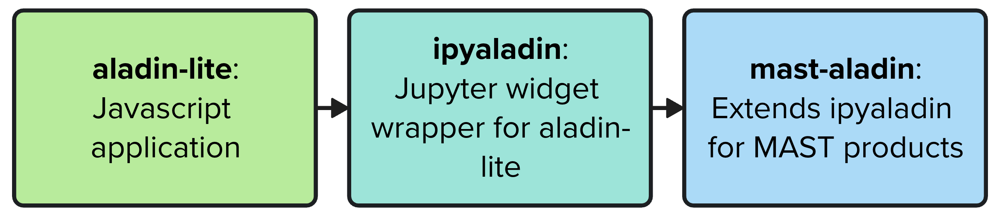

Getting started
===============

To browse Aladin in a Jupyter notebook,

.. code-block:: python

    from mast_aladin import MastAladin

    aladin = MastAladin(
        target='M82',  # supports object names, RA/Dec coord, SkyCoord
        fov=2          # [degrees]
    )

    aladin.show()

.. raw:: html

   

   

   

What is mast-aladin?
--------------------

`mast-aladin <https://github.com/spacetelescope/mast-aladin>`_ is small Python package
from the Space Telescope Science Institute that extends 
`ipyaladin <https://github.com/cds-astro/ipyaladin>`_ by CDS (Centre de Données 
astronomiques de Strasbourg). ipyaladin is a Jupyter widget wrapper for 
`aladin-lite <https://github.com/cds-astro/aladin-lite>`_, also by CDS.
`mast-aladin` adds convenience methods for visualizing and interacting with
MAST observation query results and MAST catalog query results. 

`mast-aladin` can run in any Jupyter notebook, including notebooks on the
`Roman Research Nexus <https://roman.science.stsci.edu/hub/login?next=%2Fhub%2F>`_.

